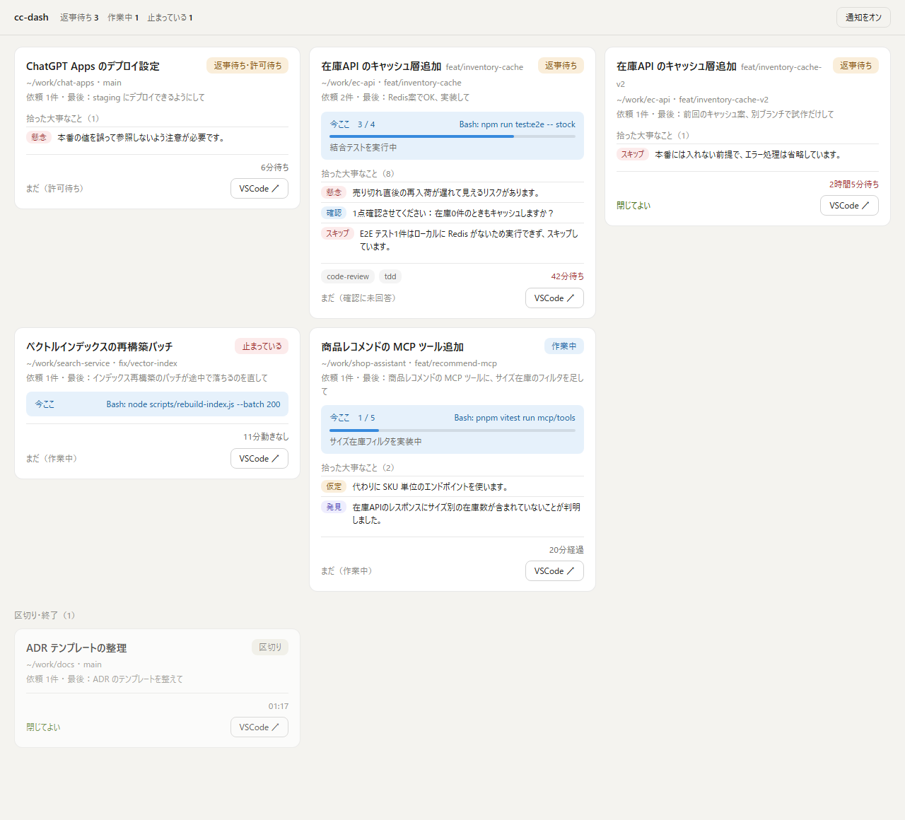
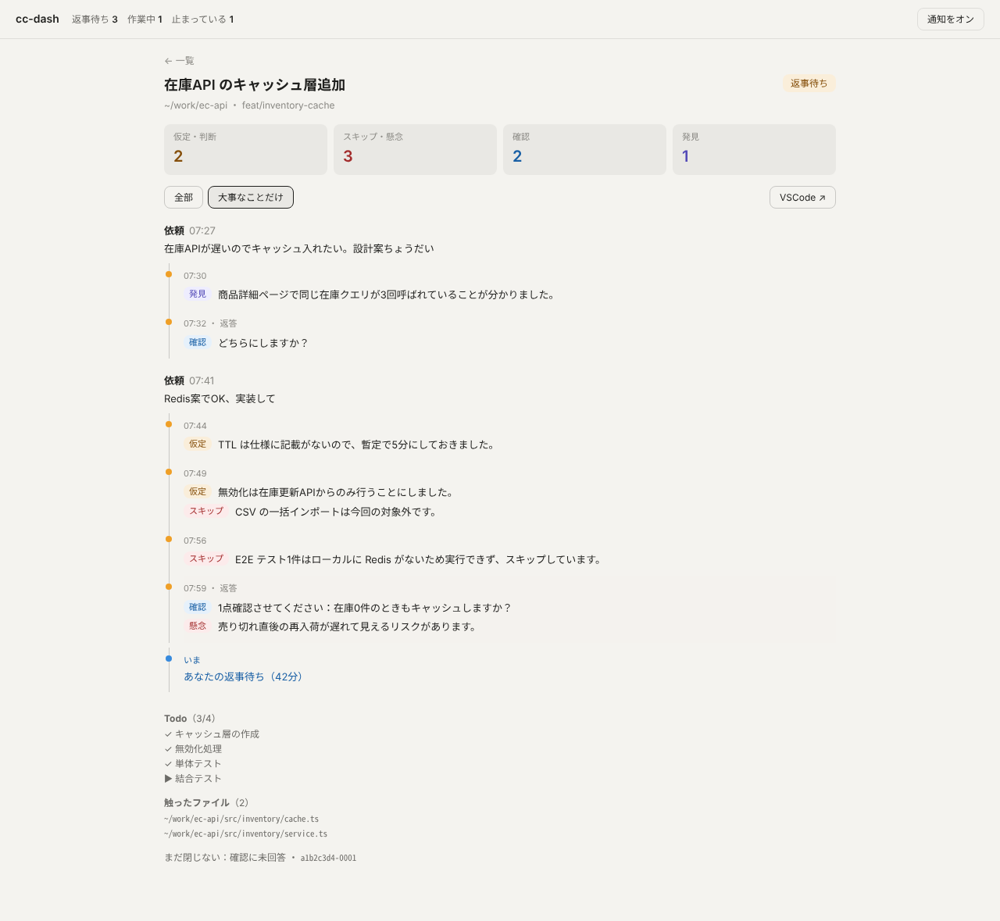

# cc-dash

Claude Code を何本も並列で走らせているときに、

- どのセッションが **自分の返事を待っているか**
- 各セッションが **今どこで何をしているか**
- 作業の途中で流れていった **大事なこと**（勝手に置いた仮定、スキップしたテスト、確認の依頼…）

を一画面で見るための、ローカル完結のダッシュボードです。外部ライブラリなし、Node.js だけで動きます。

複数の端末（例：Windows で設計、Mac で実装）のセッションを、1台にまとめて表示することもできます（[複数端末で使う](docs/multi-device.md)）。

| 一覧 | 詳細（大事なことだけ表示） |
| --- | --- |
|  |  |

※ スクリーンショットは架空のデータです（`npm run demo` で再現できます）。

## できること

**一覧（カード）**
- 「誰の番か」で決まる札：返事待ち（許可待ち・中断を含む）／作業中／止まっている／区切り／終了
- 今ここ：Claude の Todo の進み具合、今の項目、直近のツール呼び出し
- 拾った大事なこと：最新3件と件数。押すと詳細のその位置に飛ぶ
- 使ったスキル（新しい順に2つ）、待ち時間（30分を超えると赤）
- 閉じてよいか：作業中でない・許可待ちでない・最後の確認に未回答でない・未コミットの変更がない
- 見出しが重なるカードだけ、ブランチなどを添えて見分ける
- 返事待ちに変わったら、件数に関係なく音を1回だけ鳴らす（右上の「通知をオン」を押したあと）
- ピン留め：カードのピンを押すと、一覧の先頭の「ピン留め」欄に留める。いくつでも留められ、留めた順に並ぶ。もう一度押すと外す（`~/.cc-dash/pins.json` に残るので、再起動やブラウザを変えても消えない）
- 絞り込み：上の「返事待ち」「作業中」「止まっている」の件数を押すと、その札だけにする。もう一度押すと解除
- VSCode ボタン：そのセッションのタブを VSCode で開く（この端末のセッションだけ。VSCode の中のブラウザからでも使える）

**サイドメニュー**
- 全セッションを、タイトルと札だけの1行ずつで並べる。長いタイトルは省略し、マウスを載せると全文が出る
- 押すと詳細に飛ぶ。詳細を開いているセッションの行は強調する
- ピン留めしたセッションは先頭にまとめ、ほかとの間に線を引く
- 件数での絞り込みは、サイドメニューにも効く

**詳細（時系列）**
- 自分の依頼を「章」にして、その下に Claude の途中メッセージとツール呼び出しを時刻順に並べる
- 大事なことを含むメッセージは点が黄色になり、種類のラベルが付く
- 「大事なことだけ」に切り替えると、仮定・スキップ・懸念・確認・発見だけの一覧になる
- 最後に必ず「いま」（返事待ち何分／作業中の項目）が来る
- Todo と触ったファイルの一覧

## 必要なもの

- Node.js 22 以上（macOS / Windows）
- Claude Code（会話記録が `~/.claude/projects/` に出ていること）
- （任意）Haiku での分類を使う場合は、ログイン済みの `claude` コマンド

## セットアップ

```bash
git clone <このリポジトリ> cc-dash && cd cc-dash

# 1. フックを登録（~/.claude/settings.json に追記。書き込み前にバックアップを残す）
npm run hooks:install
#   中身だけ見たいとき: node scripts/install-hooks.mjs --dry-run

# 2. 起動
npm start
#   → http://127.0.0.1:4319
```

ブラウザの「アプリとしてインストール」や「ウィンドウとして開く」で単独ウィンドウにして、サブモニターに置いておくのがおすすめです。

フックは、登録後に**新しく始めたセッション**から効きます。フックがないセッションも会話記録から状態を推定して表示しますが、許可待ちの検出などは精度が落ちます。

### Haiku で「大事なこと」を分類する（任意）

```bash
npm run start:llm   # = node src/main.mjs --llm
```

途中メッセージを `claude -p --model haiku` に渡して分類し直し、セッションの1行要約も作ります。結果は `~/.cc-dash/llm-cache.json` にキャッシュするので、同じ文章で二度呼びません。起動時にさかのぼって分類するのは直近24時間分だけで、詳細画面を開いたセッションは古い分も分類します。

### 試しに動かす

```bash
npm run demo       # 架空のセッションを6本生成して起動
npm run demo:hub   # Mac 役と Windows 役の2台構成を手元で再現
npm test
```

### 複数端末で使う

Windows をハブ、Mac をエージェントにして、Tailscale 経由でまとめます。手順は [docs/multi-device.md](docs/multi-device.md)。

- Mac：`CC_DASH_HOST=<TailscaleのIP> CC_DASH_TOKEN=<トークン> CC_DASH_NAME=Mac npm start`
- Windows：`~/.cc-dash/peers.json` に Mac の URL とトークンを書いて `npm start`

### フックの削除

```bash
npm run hooks:uninstall
```

## 設定（環境変数）

| 変数 | 既定値 | 内容 |
| --- | --- | --- |
| `CC_DASH_PORT` | `4319` | 待ち受けポート |
| `CC_DASH_HOST` | `127.0.0.1` | 待ち受けアドレス。エージェントは Tailscale の IP を指定 |
| `CC_DASH_TOKEN` | なし | ループバック以外からのアクセスに必要なトークン |
| `CC_DASH_NAME` | ホスト名 | カードに出す端末名 |
| `CC_DASH_PEERS_FILE` | `~/.cc-dash/peers.json` | ハブとして集約する相手の一覧 |
| `CC_DASH_PROJECTS_DIR` | `~/.claude/projects` | 会話記録の場所 |
| `CC_DASH_DIR` | `~/.cc-dash` | イベントログとキャッシュの置き場 |
| `CC_DASH_RECENT_DAYS` | `3` | 一覧に出す会話記録の更新日数 |
| `CC_DASH_LLM` | なし | `1` で Haiku 分類を有効化 |
| `CC_DASH_LLM_MODEL` | `haiku` | 分類に使うモデル |

しきい値（止まっている判定の3分、区切りの6時間、待ち時間を赤くする30分など）は `src/config.mjs` にあります。

## 仕組み

```
Claude Code ──(会話記録を書く)──▶ ~/.claude/projects/<project>/<session>.jsonl ─┐
     │                                                                        │ 差分で読む
     └──(フック)──▶ hooks/hook.mjs ──(追記)──▶ ~/.cc-dash/events.jsonl ──────┤
                                                                              ▼
                                         src/store.mjs（1.5秒ごとにポーリング、メモリ上に状態）
                                                  │            └─▶（任意）claude -p --model haiku
                                                  ▼
                                    src/server.mjs ── /api/* と SSE ──▶ ブラウザ（public/）
                                          ▲
                     （ハブのとき）ほかの端末の cc-dash ── Tailscale ──┘
```

- **会話記録**（Claude Code が元から書いているもの）から、時系列・途中メッセージ・Todo・ツール呼び出しを組み立てる
- **フック**は、会話記録に残らない「誰の番か」の変化（`UserPromptSubmit` / `Stop` / `Notification` / `SessionStart` / `SessionEnd`）だけをイベントログに追記する。フック自体は追記しかしない
- 大事なことの抽出は、ルール（正規表現）での拾い出し → 任意で Haiku での分類、の2段構え

| ファイル | 役割 |
| --- | --- |
| `hooks/hook.mjs` | フック本体。stdin の JSON から必要な項目だけ追記 |
| `scripts/install-hooks.mjs` | settings.json への登録／削除 |
| `src/jsonl.mjs` | 追記される JSONL の差分読み |
| `src/session.mjs` | 会話記録 → 章と項目の時系列、Todo、スキル、触ったファイル |
| `src/status.mjs` | 「誰の番か」の判定 |
| `src/highlights.mjs` | ルールでの大事なことの抽出 |
| `src/llm.mjs` | Haiku での分類と要約（任意） |
| `src/store.mjs` | ポーリング、git の未コミット確認、API 用のビュー |
| `src/server.mjs` | HTTP サーバーと SSE、別端末の詳細の中継 |
| `src/main.mjs` | 起動の入口（peers.json があればハブになる） |
| `src/auth.mjs` | トークン認証（ループバックは素通し） |
| `src/peers.mjs` | ハブ側：エージェントの購読と取得 |
| `src/merge.mjs` | 自分と別端末のセッションを1つの一覧にまとめる |
| `src/pins.mjs` | ピン留めの保存（`~/.cc-dash/pins.json`） |
| `src/open.mjs` | VSCode ボタン：Claude Code 拡張の URI（`vscode://anthropic.claude-code/open?session=<ID>`）を OS に開かせる |
| `public/` | 画面（素の HTML / CSS / JS） |

設計の判断は [docs/adr/](docs/adr/) に、作った経緯は [docs/background.md](docs/background.md) にあります。

## 既知の制約

- 会話記録の形式は Claude Code の内部仕様で、公開された安定 API ではありません。バージョンアップで読めなくなる項目が出る可能性があります（読めない行は捨てて動き続けます）
- `TaskCreate` / `TaskUpdate` 形式の Todo は、タスク番号が作成順の連番だという前提で追っています
- ルールでの抽出は取りこぼしも誤検出もあります。精度が要るときは Haiku 分類を有効にしてください
- VSCode ボタンでそのセッションのタブを開けるのは、この端末のセッションだけです。別の端末のセッションは、Remote-SSH（`peers.json` の `ssh`）で作業フォルダを開くだけです
- Windows 向けの修正（`claude.cmd` の起動、パスの表示、フックのコマンド、npm スクリプト）は入れていますが、実機の Windows ではまだ動作確認していません
- 端末間の時計のずれは補正していますが、詳細画面の時刻はそれぞれの端末の時計のままです
