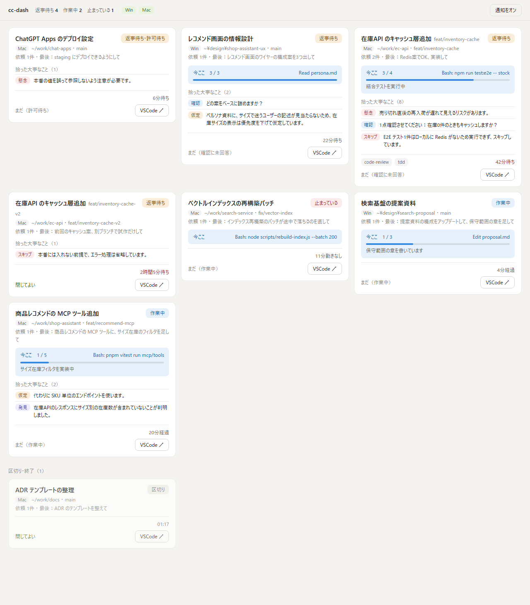

# 複数端末で使う（Windows ハブ ＋ Mac エージェント）

Windows（設計、VS Code 拡張）と Mac（実装）の両方の Claude Code を、Windows の1画面で見るための手順。設計の判断は [ADR-0005](adr/0005-multi-device-pull-over-tailscale.md)。

```
 Mac（エージェント）                      Windows（ハブ）
 cc-dash  100.x.y.z:4319  ◀── Tailscale ──  cc-dash  127.0.0.1:4319  ◀── ブラウザ
   └ Mac の会話記録を読む       トークン必須        └ Windows の会話記録 ＋ Mac の一覧をまとめる
```



## 0. 共通の準備

1. 両方の端末に [Tailscale](https://tailscale.com/) を入れて、同じアカウントでログインする
2. 両方に Node.js 22 以上と、このリポジトリを置く
3. 両方でフックを登録する：`npm run hooks:install`
4. 共通のトークンを1つ作る（どちらの端末で作ってもよい）

   ```bash
   node -e "console.log(require('crypto').randomBytes(24).toString('base64url'))"
   ```

## 1. Mac：エージェントとして常駐させる

Tailscale の IP を確認する。

```bash
tailscale ip -4   # 例: 100.101.102.103
```

まずは手で起動して確かめる。

```bash
CC_DASH_HOST=100.101.102.103 CC_DASH_TOKEN=<トークン> CC_DASH_NAME=Mac npm start
```

ログインしたら自動で起動させるには、`~/Library/LaunchAgents/dev.cc-dash.agent.plist` を作る（パスは自分の環境に合わせる。`which node` で node の場所を確認）。

```xml
<?xml version="1.0" encoding="UTF-8"?>
<!DOCTYPE plist PUBLIC "-//Apple//DTD PLIST 1.0//EN" "http://www.apple.com/DTDs/PropertyList-1.0.dtd">
<plist version="1.0">
<dict>
  <key>Label</key><string>dev.cc-dash.agent</string>
  <key>ProgramArguments</key>
  <array>
    <string>/opt/homebrew/bin/node</string>
    <string>/Users/yota/cc-dash/src/main.mjs</string>
  </array>
  <key>EnvironmentVariables</key>
  <dict>
    <key>CC_DASH_HOST</key><string>100.101.102.103</string>
    <key>CC_DASH_TOKEN</key><string>トークン</string>
    <key>CC_DASH_NAME</key><string>Mac</string>
    <key>PATH</key><string>/opt/homebrew/bin:/usr/local/bin:/usr/bin:/bin</string>
  </dict>
  <key>RunAtLoad</key><true/>
  <key>KeepAlive</key><true/>
  <key>StandardErrorPath</key><string>/tmp/cc-dash.err</string>
</dict>
</plist>
```

```bash
launchctl load ~/Library/LaunchAgents/dev.cc-dash.agent.plist
```

- `KeepAlive` にしているので、起動直後に Tailscale がまだつながっていなくて失敗しても、自動で再起動される
- `PATH` は、`git status`（閉じてよいかの判定）と `claude`（Haiku 分類を使う場合）を見つけるために要る
- macOS のファイアウォールで node への着信を聞かれたら許可する
- Mac 自身でも画面を見たいときは `http://100.101.102.103:4319/?token=<トークン>` を一度開く（cookie に保存される）

## 2. Windows：ハブとして起動する

`%USERPROFILE%\.cc-dash\peers.json` を作る。

```json
[
  { "name": "Mac", "url": "http://100.101.102.103:4319", "token": "トークン", "ssh": "yota-mac" }
]
```

- `url` は Tailscale の IP の代わりに、MagicDNS の名前（`http://yota-mac:4319` など）でもよい
- `ssh` は任意。VS Code の Remote-SSH で Mac に入るときのホスト名を書くと、Mac のセッションの VSCode ボタンが Remote-SSH で開く

起動する。

```powershell
$env:CC_DASH_NAME = "Win"
npm start
# → http://127.0.0.1:4319
```

ハブは自分の画面を見るだけなので、`127.0.0.1` で待ち受けたままでよい（トークンも不要）。

ログオン時に自動で起動させるなら、PowerShell で次を実行する（パスは自分の環境に合わせる）。

```powershell
$action  = New-ScheduledTaskAction -Execute "node" -Argument "`"$HOME\cc-dash\src\main.mjs`"" -WorkingDirectory "$HOME\cc-dash"
$trigger = New-ScheduledTaskTrigger -AtLogOn
Register-ScheduledTask -TaskName "cc-dash" -Action $action -Trigger $trigger
[Environment]::SetEnvironmentVariable("CC_DASH_NAME", "Win", "User")
```

Edge や Chrome の「アプリとしてインストール」で単独ウィンドウにして、右上の「通知をオン」を押しておく。

## 3. 確認

- 画面上部に `Win` と `Mac` の端末ラベルが並び、どちらも緑なら接続できている
- Mac が灰色の「オフライン」なら、Windows から次を試す

  ```powershell
  curl.exe -H "Authorization: Bearer <トークン>" http://100.101.102.103:4319/api/sessions
  ```

  - つながらない → Tailscale の接続、Mac の cc-dash の起動、ファイアウォールを確認
  - `401` → トークンが一致していない

## 2台構成を手元で試す

```bash
npm run demo:hub
# Mac 役のエージェント（:4320）と Windows 役のハブ（:4319）が架空データで起動する
```

## よくあること

| 症状 | 原因と対処 |
| --- | --- |
| Mac のカードが薄くなり「オフライン」 | Mac がスリープしている。復帰すると5秒ほどで再接続される |
| Mac の待ち時間がずれる | 時計のずれは自動で補正している。大きくずれるなら両方の時刻同期を確認 |
| Mac のカードに VSCode ボタンがない | `peers.json` に `ssh` を書いていない |
| Windows のセッションが出ない | フックの登録を確認し、Claude Code を開き直す。会話記録は `%USERPROFILE%\.claude\projects` |
